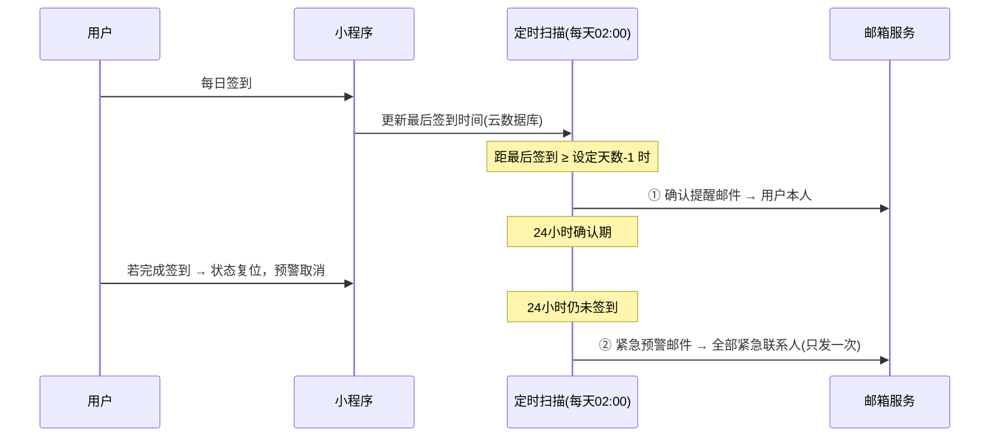

# 失联安全签到 DeadManSwitch-SafetyCheckin

> 基于**微信小程序云开发（CloudBase）**的「死亡开关 / Dead Man's Switch」安全签到工具。
> 每天一次签到报平安；若你突然失联，系统自动通过**邮件**通知你信任的紧急联系人。

   

---

## ⚠️ 免责声明（务必先阅读）

1. **本项目仅为编程学习 Demo**，仅供开源学习与技术交流，**严禁商用**（详见 [LICENSE](./LICENSE)）。
2. 本项目不构成任何安全承诺：定时任务可能延迟、邮件可能丢失或进入垃圾箱。**因误触发预警、预警未送达等原因造成的任何纠纷与后果，由使用者自行承担**，项目作者不承担任何责任。
3. 使用本项目必须遵守**《中华人民共和国网络安全法》《中华人民共和国个人信息保护法》**等相关法律法规，不得采集、存储、处理或传播他人个人信息及任何违法信息；添加紧急联系人邮箱前请征得对方同意。
4. 请勿在项目中存储真实敏感信息；`config.js` 中存放邮箱授权码，已通过 `.gitignore` 排除，**严禁提交到 GitHub 或其他公开仓库**。

---

## 一、项目介绍

**死亡开关（Dead Man's Switch）** 的核心思想：用户定期执行一个"我还活着"的信号（签到），一旦信号长时间中断，系统就自动执行预设动作（通知紧急联系人）。常用于独居者、户外探险者、高危职业者的安全兜底。

本项目是它的一个**微信小程序学习版实现**：

- 前端：微信小程序原生开发（WXML / WXSS / JS），无第三方 UI 框架
- 后端：微信云开发 CloudBase（云函数 + 云数据库 + 定时触发器），**无需自备服务器**
- 通知：**全部走邮件（nodemailer + SMTP）**，刻意不使用微信订阅消息——订阅消息需要用户逐条授权且有次数限制，邮件则无限制、跨平台、可转发

> **为什么不用微信订阅消息？**
> 订阅消息存在"一次授权只能发一条"、模板审核等限制，无法满足"失联后自动、可靠、可重复通知"的诉求；邮件天然规避了这些权限限制。

## 二、功能说明

| 功能 | 说明 |
| --- | --- |
| 微信一键登录 | 通过云函数静默获取 openid，**无需弹窗授权**；首次登录自动建档 |
| 一键签到 | 首页大按钮，点击即刷新「最后签到时间」并存入云数据库 |
| 预警倒计时 | 首页实时展示距离触发预警的剩余天数，随状态变色（蓝/橙/红） |
| 失联判定天数 | 自定义 1~365 天，**默认 7 天**，设置页可随时修改 |
| 我的姓名 / 邮箱 | 预警前先发确认提醒邮件到本人邮箱 |
| 紧急联系人管理 | 添加 / 编辑 / 删除，最多 10 位，均填写**邮箱地址**，带格式校验 |
| 定时扫描 | 云函数定时触发器，**每天凌晨 2:00**（北京时间）自动扫描全部用户 |
| 两段式预警 | 先提醒本人 → 24 小时确认期 → 未签到才通知全部联系人 |
| 纯邮件通知 | 不使用微信订阅消息，规避订阅消息权限限制 |
| 测试邮件 | 设置页一键发送测试邮件，验证 SMTP 配置 |

### 预警机制时序（核心逻辑）



判定细则：

- 剩余 **1 天**（即已连续 `设定天数 - 1` 天未签到）：给本人发确认提醒，进入 24h 确认期
- 24 小时内签到：状态立即复位，**取消**对联系人的预警
- 24 小时后仍未签到：向**全部**紧急联系人发送预警邮件（**只发一次**，避免骚扰；用户重新签到后整个周期复位重算）
- 若用户未绑定本人邮箱：跳过提醒邮件，但仍保留 24h 缓冲期，之后才通知联系人

## 三、目录结构

```text
DeadManSwitch-SafetyCheckin
├── miniprogram/                    # 小程序前端
│   ├── app.js                      # 全局入口：云开发初始化（★需填环境ID，留空用默认环境）
│   ├── app.json                    # 全局配置：页面注册 / tabBar / 窗口
│   ├── app.wxss                    # 全局样式：卡片 / 按钮 / 表单等通用样式
│   ├── sitemap.json                # 站点地图：禁止微信搜索收录（隐私）
│   ├── assets/
│   │   └── tabbar/                 # tabBar 图标（4 张 PNG）
│   ├── utils/
│   │   ├── cloud.js                # 云函数调用统一封装（约定 {success, message}）
│   │   └── util.js                 # 工具函数：时间格式化 / 邮箱校验 / 天数计算
│   └── pages/
│       ├── index/                  # 首页：一键登录 + 签到 + 预警倒计时
│       ├── settings/               # 设置：姓名 / 本人邮箱 / 失联天数 / 测试邮件
│       ├── contacts/               # 紧急联系人列表（编辑 / 删除）
│       └── contact-edit/           # 联系人添加 / 编辑表单
├── cloudfunctions/                 # 云函数
│   ├── login/                      # 微信一键登录（静默 openid + 自动建档）
│   ├── checkin/                    # 签到：更新最后签到时间并复位预警
│   ├── updateUser/                 # 保存设置（姓名 / 邮箱 / 失联天数）
│   ├── contact/                    # 联系人增删改查（list/add/update/delete）
│   ├── dailyScan/                  # ★ 定时任务：每日 2 点扫描 + 两段式预警
│   │   ├── config.json             #   定时触发器配置（0 0 2 * * * *）
│   │   ├── config.example.js       #   SMTP 配置模板（提交到 GitHub）
│   │   ├── config.js               #   SMTP 实际配置（已 gitignore，填授权码）
│   │   ├── mailer.js               #   nodemailer 封装 + 邮件模板
│   │   └── index.js                #   扫描判定主逻辑
│   └── testEmail/                  # 测试邮件（验证 SMTP 配置）
├── project.config.json             # 开发者工具项目配置
├── project.private.config.json     # 本地个性化配置（已 gitignore）
├── .gitignore                      # 忽略 node_modules / 密钥 / 本地配置
├── LICENSE                         # 学习使用许可（禁止商用）
└── README.md
```

## 四、部署步骤（总览）

> 详细分步教程见下文第五、六、七节。部署全程约 15~30 分钟。

**前置条件：**

- 一个微信小程序账号（个人主体即可，免费注册）：[https://mp.weixin.qq.com](https://mp.weixin.qq.com)
- 微信开发者工具（稳定版）：[官方下载](https://developers.weixin.qq.com/miniprogram/dev/devtools/download.html)
- 一个用于发件的邮箱（推荐 QQ 邮箱）+ 开启 SMTP 服务获得的**授权码**

**部署检查清单：**

- [ ] 1. 开发者工具导入本项目，填入自己的 AppID
- [ ] 2. 开通云开发，创建环境，记下环境 ID
- [ ] 3. （可选）把环境 ID 填入 `miniprogram/app.js` 的 `CLOUD_ENV`
- [ ] 4. 右键依次上传部署 6 个云函数（云端安装依赖）
- [ ] 5. 右键 `dailyScan` → **上传触发器**（定时任务）
- [ ] 6. 复制 `config.example.js` → `config.js`，填入 SMTP 授权码，重新部署 `dailyScan` 和 `testEmail`
- [ ] 7. 手机预览：登录 → 设置页保存资料 → 发送测试邮件
- [ ] 8. 云开发控制台手动运行一次 `dailyScan` 验证扫描逻辑

## 五、云开发开通教程

1. **注册小程序账号**：在 [微信公众平台](https://mp.weixin.qq.com) 注册个人主体小程序，完成后在 *设置 → 基本设置* 中找到 **AppID** 并复制。
2. **导入项目**：打开微信开发者工具 → 导入 → 选择本项目根文件夹 → AppID 填入你自己的（没有可先选"测试号"，但云开发要求正式 AppID）。
3. **开通云开发**：点击工具栏的 **「云开发」** 按钮 → 同意协议 → **开通** → 创建环境（如 `dev-1`）。免费额度足够个人学习使用，创建后会显示你的**环境 ID**（形如 `dev-1-8g0a2b3c4d`）。
4. **配置环境 ID**：打开 `miniprogram/app.js`，将环境 ID 填入 `CLOUD_ENV`（只有**一个**环境时留空也可）。
5. **数据库集合**：`users` 和 `contacts` 两个集合会在首次调用 `login` 云函数时**自动创建**，无需手动建表。如需手动创建：云开发控制台 → 数据库 → 新建集合，权限选「仅创建者可读写」即可（本项目前端不直连数据库，全部经云函数读写）。
6. **部署云函数**：在开发者工具左侧资源管理器中，对 `cloudfunctions` 下的每个文件夹（共 6 个）**右键 → 上传并部署：云端安装依赖（不上传 node_modules）**。
7. **上传定时触发器**：右键 `dailyScan` 文件夹 → **上传触发器**。可在云开发控制台 → 云函数 → 定时触发器中确认已创建（`0 0 2 * * * *` = 每天北京时间 02:00:00）。
8. **运行验证**：云开发控制台 → 云函数 → `dailyScan` → 云端测试 → 直接运行，返回的 JSON 报告（`scanned / reminded / alerted`）即扫描结果。

## 六、邮箱配置教程（SMTP 授权码）

> 代码使用 nodemailer 发信，SMTP 参数与授权码存放在云函数目录的 `config.js` 中。
> `dailyScan` 和 `testEmail` 两个目录**都需要配置**。

### 1. 生成配置文件

```bash
# 分别进入两个云函数目录，各复制一份
cp cloudfunctions/dailyScan/config.example.js cloudfunctions/dailyScan/config.js
cp cloudfunctions/testEmail/config.example.js cloudfunctions/testEmail/config.js
```

然后编辑两个 `config.js`，填入你的发件邮箱和授权码（示例为 QQ 邮箱）：

```js
module.exports = {
  host: 'smtp.qq.com',   // QQ 邮箱 SMTP 服务器
  port: 465,             // SSL 端口
  secure: true,          // 465 端口固定为 true
  fromName: '失联安全签到',
  auth: {
    user: 'your_email@qq.com',   // ← 你的发件邮箱
    pass: '请填入你的SMTP授权码'  // ← 你的授权码（不是邮箱密码！）
  }
}
```

### 2. QQ 邮箱获取授权码（推荐）

1. 浏览器登录 [mail.qq.com](https://mail.qq.com) → **设置 → 账号**
2. 找到「POP3/IMAP/SMTP 服务」→ 开启服务
3. 按提示短信验证后**生成授权码**（16 位字母），复制填入 `config.js` 的 `auth.pass`
4. 重新部署：右键 `dailyScan`、`testEmail` → 上传并部署

### 3. 其他邮箱

| 邮箱 | host | port | 备注 |
| --- | --- | --- | --- |
| QQ 邮箱 | `smtp.qq.com` | 465 | 推荐个人使用 |
| 163 邮箱 | `smtp.163.com` | 465 | 需在设置中开启 SMTP 并获取授权码 |
| Outlook | `smtp.office365.com` | 587 | `secure: false` |
| Gmail | `smtp.gmail.com` | 465 | 国内网络环境不推荐 |

### 4. 验证

小程序设置页填写**你的邮箱**并保存 → 点击 **「发送测试邮件」** → 收到邮件即配置成功（注意垃圾箱）。

## 七、数据库设计

### users 集合（用户信息，`_id` = openid）

| 字段 | 类型 | 说明 |
| --- | --- | --- |
| `openid` | string | 微信用户唯一标识 |
| `selfName` | string | 用户姓名（预警邮件中向联系人说明身份） |
| `myEmail` | string | 用户本人邮箱（接收预警确认提醒） |
| `thresholdDays` | number | 失联判定天数（1~365，默认 7） |
| `lastCheckinTime` | date | 最后签到时间（**核心字段**） |
| `alertStatus` | string | 预警状态：`normal` 正常 / `pre_alert` 待确认 / `alerted` 已预警 |
| `preAlertSentAt` | date / null | 确认提醒邮件发送时间（计算 24h 确认期） |
| `alertedAt` | date / null | 预警邮件发送时间 |
| `createdAt` / `updatedAt` | date | 创建 / 更新时间 |

### contacts 集合（紧急联系人，`userId` 关联 users.openid）

| 字段 | 类型 | 说明 |
| --- | --- | --- |
| `userId` | string | 归属用户的 openid |
| `name` | string | 联系人姓名（≤ 20 字） |
| `email` | string | 联系人邮箱（预警接收地址） |
| `createdAt` / `updatedAt` | date | 创建 / 更新时间 |

> 性能建议：生产环境可在 `users.openid`、`contacts.userId` 上建索引（控制台 → 数据库 → 索引管理）。本项目用 `_id = openid` 保证一人一条，天然防并发重复注册。

## 八、常见问题 FAQ

**Q1：测试邮件报错「SMTP 尚未配置」？**
`config.js` 不存在或授权码未填写。复制 `config.example.js` 为 `config.js`，填好后**重新上传部署** `dailyScan` 和 `testEmail`。

**Q2：测试邮件报「535 认证失败 / Mail send failed」？**
授权码错误，或邮箱的 SMTP 服务未开启。注意：**授权码 ≠ 邮箱登录密码**。

**Q3：邮件收不到？**
先看垃圾邮件文件夹；再确认收件邮箱拼写；QQ 邮箱有发信频率限制，短时间大量发送会被临时拦截。

**Q4：定时任务没有执行？**
云开发控制台 → 云函数 → `dailyScan` → 确认「定时触发器」存在且已启用；触发时间为北京时间每天 02:00。也可在「云端测试」手动运行一次验证逻辑。

**Q5：想立即验证预警流程怎么办？**
方案一：把失联天数改为 1 天，之后 1~2 天内不签到，观察两段式邮件；方案二：云开发控制台手动把某用户的 `lastCheckinTime` 改到 10 天前，再手动运行 `dailyScan`。

**Q6：修改了失联天数多久生效？**
下次定时扫描（次日 02:00）生效；页面上的剩余天数倒计时立即生效。

**Q7：预览时报「云函数不存在」？**
对应的云函数还没上传部署，检查 6 个函数是否都部署了；函数名必须与文件夹名一致。

**Q8：云端安装依赖失败？**
换用本地安装：本机安装 Node.js 后，在对应云函数目录 `npm install`，再右键「上传并部署：所有文件」。

**Q9：邮件一直重复发？**
不会。预警邮件只发一次（状态 `alerted`），用户签到后才复位。若异常可手动把 `alertStatus` 改回 `normal`。

## 九、GitHub 开源说明

本项目为个人学习开源项目，欢迎 **Star / Fork / Issue / PR**。

### 上传到 GitHub 的步骤（首次）

```bash
# 1. 进入项目目录
cd DeadManSwitch-SafetyCheckin

# 2. 初始化本地仓库并提交
git init
git add .
git commit -m "feat: 失联安全签到——基于微信云开发的死亡开关学习项目"

# 3. 在 GitHub 网页上新建一个空仓库（不要勾选 README/License），
#    然后关联远程并推送（替换为你的仓库地址）
git remote add origin https://github.com/<你的用户名>/DeadManSwitch-SafetyCheckin.git
git branch -M main
git push -u origin main
```

### 安全须知

- `.gitignore` 已排除 `cloudfunctions/**/config.js`（含授权码）、`node_modules`、`project.private.config.json` 等，**首次 clone 本仓库后需按第六节自行创建 `config.js`**。
- 提交前可用 `git status` 确认 `config.js` 未被追踪；万一误提交，请立即去邮箱服务商处**重置授权码**。

## 十、License

本项目采用自定义的 [学习使用许可（Educational Use License）](./LICENSE)：**仅供个人学习、研究与教学交流，严禁商用**。二次分发请保留该许可文件。

---

再次提醒：本项目仅为编程学习 Demo，预警能力不能替代真实的安全保障措施；误触发预警造成的纠纷由使用者自行承担；使用本项目需要遵守国家网络安全、个人信息保护相关法律法规。
